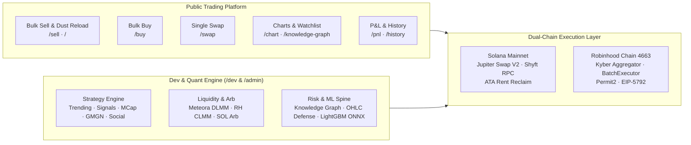

# Welcome to reloadSol

**reloadSol** is a dual-chain trading and algorithmic execution platform built for **Solana Mainnet** and **Robinhood Chain (EVM Chain ID `4663`)**.

For everyday traders, reloadSol turns fragmented wallet dust and multi-token portfolios back into native **SOL** or **ETH** in 1–2 clicks—reclaiming locked Solana token account rent along the way—while also providing multi-token bulk buys, single-pair swaps, real-time charts, cross-chain watchlists, and receipt-verified P&L tracking.

The automated strategy engine, `/dev/*` operator consoles and `/admin/*` evaluation suites are documented in a separate **internal** space, available to the team only — they are intentionally not part of this public site.

---

## Choose Your Track

| Audience | Start Here | What You Will Learn |
| :--- | :--- | :--- |
| **New & Active Traders** | [Quickstart Guide](getting-started/quickstart.md) | Connect your wallet, sweep dust into SOL/ETH, reclaim rent, execute bulk buys, and track P&L. |
| **Execution & Risk Deep Dive** | [Order Execution, Slippage & Fees](trading/order-execution-and-mechanics.md) | How Jupiter Swap V2, Kyber, BatchExecutor, dynamic slippage, and pre-sign simulation work. |
| **Risk & Exit Mechanics** | [Stop-Loss, Take-Profit & In-Flight OHLC Defense](risk-and-mechanics/sl-tp-and-exit-protection.md) | How positions are protected in flight and how rug detection gates entries. |

---

## Platform Capabilities at a Glance

### Supported Networks

| Feature | Solana Mainnet (`sol`) | Robinhood Chain (`robinhood`, EVM `4663`) |
| :--- | :--- | :--- |
| **Native / Quote Assets** | SOL, USDC, USDT | ETH, WETH, USDG |
| **Primary Swap Aggregator** | Jupiter Swap V2 (`/order` + `/execute`), Lite fallback | KyberSwap Aggregator (Parent Wallet) / GMGN (Bound Wallet) |
| **Batch Execution** | Parallel v0 transactions, single `signAllTransactions` approval | Atomic `BatchExecutor.sol` (`executeBatch`) → EIP-5792 → Sequential |
| **Dust & Account Cleanup** | Sellable dust sweep + SPL/Token-2022 burn & empty-ATA rent reclaim | Multi-token ERC-20 batch sell to ETH or custom output token |
| **Public Access** | Open to all Solana wallets | Dev-wallet / `RH_WHITELIST` / EVM provider gated |
| **Automated Strategies** | Paper (`sim_only`), Live (`live_only`), and A/B (`ab_parallel`) | Paper (`sim_only`) + alert-only CLMM monitoring |


**Non-Custodial by Design (Public Surfaces):** On all public trading pages (`/sell`, `/buy`, `/swap`), reloadSol never holds your private keys. Every swap, burn, and account close is simulated against live RPC state before being presented to your browser wallet (Phantom, Rabby, or any EIP-6963 / Solana Wallet Adapter wallet) for explicit signature approval.


---

## Core Design Principles

1. **Receipt-Gated Settlement Honesty:** A trade is never marked `confirmed` when a transaction is merely submitted. reloadSol tracks `pending` → `confirmed` or `failed` strictly from verified on-chain receipts.
2. **Exact-Bytes Pre-Sign Simulation:** Before your wallet opens a signature prompt, reloadSol simulates the exact serialized transaction bytes with a live blockhash (no `replaceRecentBlockhash` shortcuts and no `skipPreflight: true` bypasses).
3. **One Live Price Source:** reloadSol forbids hardcoded native asset fallback prices. If live price feeds are unreachable, surfaces explicitly display unavailable state (`—`) rather than fabricating P&L or USD estimates.
4. **Shadow-First Quant Discipline:** Every new risk gate, knowledge graph veto, and machine learning classifier runs in `shadow` mode first—recording counterfactual outcomes against live 1-minute OHLC bars before enforcement is ever enabled.
