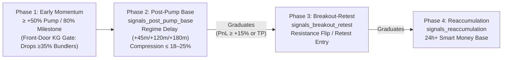

# Strategy Engine, Signals & Algo Tester

reloadSol's strategy engine unifies automated discovery, paper validation, and live execution across six trading domains—all sharing one canonical parameter spine (`src/strategies/canonical-params.ts`), one outcome ledger (`strategy_outcomes`), and one unified exit owner (`sltp_monitor`).

---

## 1. Anatomy of a Strategy

Every strategy consists of:

1. **Typed Registry Default (`src/strategies/registry.ts`):** Baseline entry filters, stop-loss/take-profit rules, stake sizes, and notification settings.
2. **Database Override (`strategy_definitions`):** Chain-scoped (`chain = 'sol' | 'robinhood'`) runtime overrides editable from `/dev/algo-tester` via `PATCH /api/strategies/[id]` (deep-merged without wiping sibling keys).
3. **Execution Mode (`execution_mode`):**
   * `sim_only` — Paper trading only (all Robinhood Chain strategies stay `sim_only`).
   * `live_only` — Real capital execution via server keypair / bound wallet.
   * `ab_parallel` — Runs paper and live in parallel for A/B fill parity comparison (Signals and DLMM).
4. **Kill Switch (`is_active`):** Toggling a strategy inactive immediately triggers `closeOpenPositionsForStrategy({ chain })`, force-closing open `sl_tp_positions`, sim holdings, and DLMM positions with `close_reason = 'strategy_deactivated'`.

---

## 2. Strategy Domains & Registered Playbooks

| Domain | Discovery Input | Key Registered Strategies | Console Route |
| :--- | :--- | :--- | :--- |
| **`trending_bot`** | GMGN market rank (`TRENDING_FEED=gmgn`) or Jupiter `toptrending/1h` | `att` / `att_rh` (TP1 45% sell 90%, TP2 100%, SL -35%), `lowcap_moonbag` (35k–90k MC, TP 200/400/600%), `scalper`, `hodl` | `/dev/algo-tester` |
| **`signals`** | `token_mcap_tracking`, 1m OHLC structure, KG & macro regime | `signals_default` / `_rh`, `signals_sell_over_100`, `signals_early_surge_scalp`, 4-phase lifecycle (`signals_post_pump_base`, `signals_breakout_retest`, `signals_reaccumulation`), Mid-Cap Trio (`signals_raydium_squeeze`, `signals_dex_trending_flow`, `signals_vwap_shelf_breakout`) | `/dev/signals` · `/admin/lifecycle` |
| **`mcap_tracker`** | Market cap snapshots & milestone triggers | `mcap_enter_first_seen` (+ `_rh`), `mcap_enter_at_80` (+ `_rh`, primary thesis filling at live `current_mcap`) | `/dev/algo-tester` |
| **`gmgn`** | GMGN Smart Money & KOL 60m activity + Wallet Digger roster | `gmgn_smartmoney_default`, `gmgn_kol_momentum`, `gmgn_sm_kol_combined` (+ RH twins), `gmgn_roster_concurrence` (inactive by default; clean security gate + Telegram Radar cards) | `/dev/algo-tester` |
| **`social`** | Telethon Telegram channel ingest (`social_token_events`) & tracked wallet polls | `social_only_fomo_gt7` (FOMO mentions `> 7 / 30m`, Jev Noul shadow gate, moonbag peak-trailing exit) | `/dev/social` · `/dev/fomo` |
| **`dlmm`** | Meteora DLMM & Robinhood CLMM pool screeners | `dlmm_default`, `dlmm_range_fee_accumulator` | `/dev/dlmm` |

---

## 3. The 4-Phase Viral Runners Lifecycle (`/admin/lifecycle`)

Rather than chasing every raw launch in the bonding-curve graveyard, reloadSol's lifecycle engine graduates survivors through four structured phases (`SPEC-viral-runners-lifecycle-regime-defense-v1`):

* **Parallel Fast-Cycle Lane (`signals_early_surge_scalp`):** Runs alongside Phase 2 to capture early `$15k → $60k` MC impulse waves on clean tokens (`bundlers < 20%`, clean deployer pedigree, 3 green 1m candles or Smart Money buy), relying on In-Flight OHLC 3-Pattern Defense (Pattern A `-6%`, Pattern B `-5%`, Pattern C breakeven at `+18%`, 2-bar trail at `≥ +30%`).
* **Mid-Cap Advanced Trio (`$250k – $1M` MC tier):** Captures deeper-liquidity continuation setups where empirical breakout rates are `35.2%` (vs. `5.8%` at bonding curve launch):
  * `signals_raydium_squeeze` (post-graduation 5m higher-low squeeze)
  * `signals_dex_trending_flow` (buyer diversity `≥ 1.5` to defeat cabal wash trades)
  * `signals_vwap_shelf_breakout` (15m Anchored VWAP breakout + Bollinger Band squeeze `≤ 12%` + positive CVD)

---

## 4. Algo Tester (`/dev/algo-tester`) & Paper Readiness (`/dev/paper-trade`)

### Algo Tester (`/dev/algo-tester`)
Unified **four-tab** operational hub (`ALGO_TESTER_TABS = ["config", "open", "closed", "health"]` in `src/components/algo-tester/algo-tester-query.ts`):
* **Config:** Edit strategy parameters, toggle `is_active`, switch `execution_mode`, configure Telegram/UI notifications, and inspect/trigger Go cron workers (`?panel=workers`). A card shows only the fields it overrode — everything else sits behind a *"show inherited (N)"* toggle, inherited greyed and overrides bold, and a never-overridden section collapses instead of leaving an empty titled shell.
* **Open:** Live cross-domain open position monitor (`getAlgoPositions`).
* **Closed:** Outcome tables, P&L digests, Pattern ML columns, and human review labeling.
* **Health:** The `WorkersTable` (one copy, not two) with `domain_heartbeat`, plus the Early-Enter Noul funnel. Read-only evidence lives here, never in the Config tab — five read-only surfaces rendered inside a config editor was the single largest source of the page feeling "all over the places".

### Paper-Desk Readiness (`/dev/paper-trade`)
Answers one decision question: **Is a strategy genuinely ready to arm with real capital?**
* Rebuilds every position directly from raw `trading_records` legs (`summarizeLedgerPositions`) and displays `summary.costModel`.
* Excludes legacy nominal-price data defects (`$0.000001` sentinel) transparently via `excludedNominal` rather than polluting returns.
* Enforces a minimum sample floor (`READINESS_MIN_SAMPLE = 30` closed trades): below 30 closes, `verdict` reads `insufficient` so small-sample noise is never mistaken for edge.
* Reports **median** return per trade, **net-of-fee** expectancy, current **climate multiplier**, and **`peakConcurrentPositions`** (to size against `MAX_SOL_AT_RISK`).

---

## 5. Re-Entry Cooldowns & Walk-Forward Strategy Search

To prevent strategies from repeatedly re-buying a dying token on the way down, every domain enforces cooldowns keyed on `strategy_outcomes`:

| Guard | Default Window |
| :--- | :--- |
| **MCap Sim One-Shot** | `1×` per `(strategy_id, mint)` — permanently blocked after first close |
| **Trending Bot Re-Entry** | `TRENDING_REENTRY_COOLDOWN_MIN = 1440` (24h) · max `2` purchases per token |
| **GMGN Discovery Cooldown** | `24h` (`6h` for roster) |
| **DLMM Reopen Cooldown** | `60 min` per pool · `1,440 min` (24h) per token |

Additionally, `strategy_search` runs every `6h` (`POST /api/strategies/search-cycle`) performing walk-forward grid evaluation over closed outcomes—pruning underperforming `search_*` clones (cap 3) and promoting verified winners onto canonical **sim** configurations.

---

## 6. Interactive Lab: Viral Runners Lifecycle & Macro Regime

Switch between **`MOMENTUM_RUNNER`**, **`NORMAL_CHOP`**, and **`DEFENSIVE`** regimes and adjust bundler concentration (`bundlers_hold_pct`) and climate state to see how the 4-phase funnel responds in real time:


Interactive reloadSol 4-Phase Viral Runners & Macro Regime Simulator

