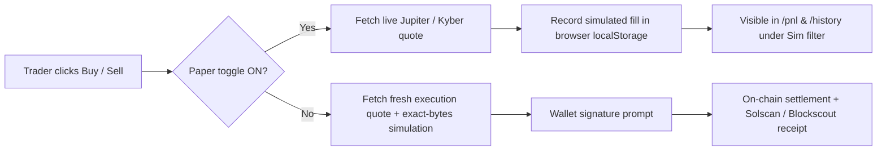

# Practice with Paper mode

**TL;DR:** Toggle **Paper** in the header to test `/buy`, `/sell`, `/pnl`, and `/history` with **1 SOL + 1 ETH/day** of simulated funds—no wallet connection and zero real signatures.

[Try Paper mode on reloadSol →](https://reloadsol.app/buy/solana)

---

## Start practicing in 3 steps



### Open reloadSol

Go to [reloadsol.app](https://reloadsol.app/). You do **not** need to connect Phantom, Solflare, or Rabby.



### Turn on the Paper toggle

Click the **Paper** switch in the top header. Your browser creates a local paper ledger with **1 SOL** (and **1 ETH** on Robinhood Chain) that resets daily at **00:00 WIB (Asia/Jakarta)**.



### Place simulated buys and sells

Open [Bulk Buy](https://reloadsol.app/buy/solana) or [Bulk Sell](https://reloadsol.app/sell/solana). Fills use live Jupiter or Kyber quote outputs and appear immediately in [P&L](https://reloadsol.app/pnl) and [History](https://reloadsol.app/history) under the **Sim** filter.



---

## Paper vs. live execution flow

---

## What Paper mode models (and what it does not)

| Aspect | Modeled in Paper mode? | Details |
| :--- | :--- | :--- |
| **Live DEX quote prices** | **Yes** | Uses real Jupiter / Kyber quote output amounts. |
| **Wallet signatures & real gas** | **No** | Never prompts your wallet or spends real SOL/ETH. |
| **On-chain landing failures / MEV** | **No** | Simulated fills do not experience RPC drops or sandwiching. |
| **Single Swap (`/swap`)** | **Blocked for safety** | Jupiter Terminal is deliberately unmounted in Paper mode so it can never prompt a real signature; use `/buy` and `/sell` instead. |


**Browser-local storage:** Your Paper mode ledger is stored in your browser's `localStorage`. Clearing site data or switching browsers resets your simulated history.


---

## Related

* [Quickstart Guide](quickstart.md)
* [What is checked before you sign](paper-trading-and-safety.md)
* [P&L Tracker, Trade History & Portfolio](../trading/pnl-history-and-portfolio.md)
