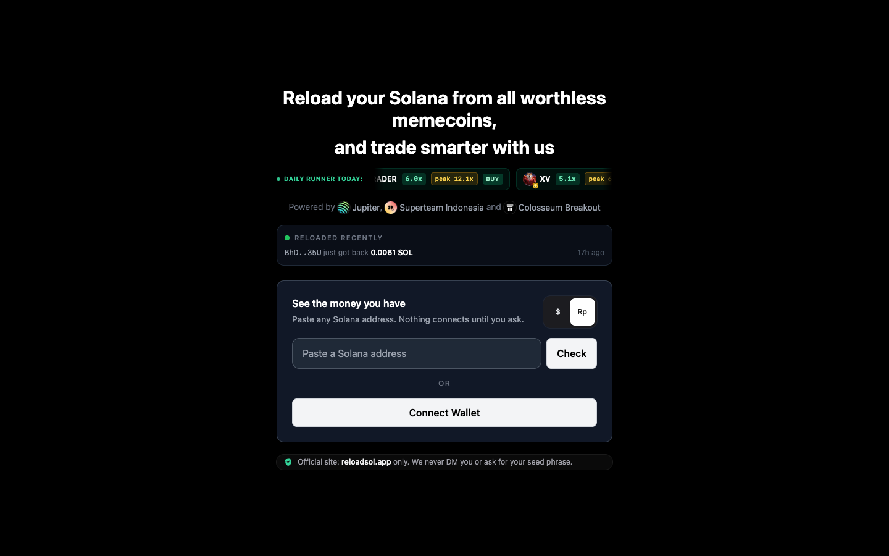

# Quickstart Guide

**TL;DR:** Open [reloadsol.app](https://reloadsol.app/), paste any Solana address to check recoverable SOL, or connect Phantom/Solflare to sweep dust on `/sell/solana`. Want to test first with no wallet? Turn on **Paper** in the header for **1 SOL/day** of simulated fills.

[Open reloadSol →](https://reloadsol.app/)

---

## Your first dust reload



### Open reloadsol.app

Visit [https://reloadsol.app/](https://reloadsol.app/). Before connecting, you can paste any Solana wallet address into **Wallet Check** to see your native SOL, sellable token value, and reclaimable [ATA rent](trading-terms.md#portfolio-and-balances).



### Connect your wallet (or turn on Paper mode)

Click **Connect Wallet** and pick Phantom, Solflare, or Backpack (or Rabby on Robinhood Chain). After connecting, reloadSol routes you straight to [Bulk Sell](https://reloadsol.app/sell/solana).



### Select tokens and output asset

Click **Dust only**, **Select All**, or pick individual rows with quick presets (`10%`, `20%`, `50%`, `75%`, `100%`). Toggle **Show zero balance** to include empty Solana accounts holding `~0.00203928 SOL` in rent. Keep **SOL** (or **ETH**) as output, or pick a custom token.



### Simulate, sign, and confirm

Click **Sell / Reload**. reloadSol simulates the exact transaction bytes against live RPC state before opening your wallet prompt. Approve once and wait for the modal to show **Confirmed** with your Solscan or Blockscout link.




**Stuck with 0 SOL for gas?** If **Wallet Check** on [reloadsol.app](https://reloadsol.app/) finds sellable tokens or closable accounts while your SOL balance is near zero, click **Ask for Fund** to request manual gas assistance from the ops desk.



**Check before signing:** Live on-chain swaps and token burns are irreversible. Read [Stay safe on reloadSol](safety-and-security.md) and [Risk disclosure](../help/risk-disclosure.md) before approving live transactions.


---

## Related

* [Trading terms in 5 minutes](trading-terms.md)
* [Practice with Paper mode](paper-mode.md)
* [Sweep dust & reclaim rent](../trading/bulk-sell-and-dust-reload.md)
* [Troubleshooting & FAQ](../help/troubleshooting-and-faq.md)
