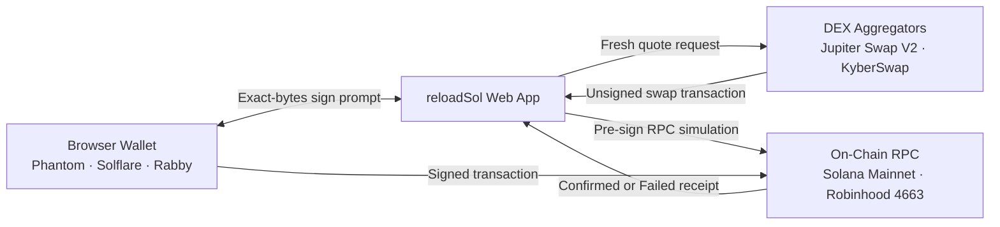

# Routing, architecture & data feeds

**TL;DR:** reloadSol is a **non-custodial web application**—your private keys never leave your browser wallet. Quotes are fetched from DEX aggregators, simulated with exact transaction bytes before signing, and settled directly on-chain.

[Open reloadSol →](https://reloadsol.app/)

***

## Non-custodial signing & routing architecture

### Security boundaries

1. **Zero custody:** reloadSol never holds user funds, seed phrases, or private keys. Every live transaction requires an explicit signature inside your wallet extension.
2. **Exact-bytes pre-sign simulation:** Before your wallet opens a signing prompt, reloadSol simulates the exact serialized bytes against live RPC state. Stale blockhashes rebuild once automatically; failing legs are split or rejected before you sign.
3. **Receipt-gated settlement:** A trade is marked **Confirmed** only after an on-chain receipt succeeds and links to Solscan (Solana) or Blockscout (Robinhood Chain).

***

## Public data feeds & integrations

| Capability                   | Solana Mainnet                          | Robinhood Chain (`4663`)           | Purpose                                                                                 |
| ---------------------------- | --------------------------------------- | ---------------------------------- | --------------------------------------------------------------------------------------- |
| **Swap quoting & routing**   | Jupiter Swap V2                         | KyberSwap Aggregator               | Best-route pricing, dynamic slippage (`0.50%–10.00%`), and `15%` price-impact rejection |
| **Batch execution**          | Coordinated multi-leg wallet batching   | Permit2 + BatchExecutor / EIP-5792 | Single-flow bulk buys (up to 4 tokens) and dust sweeps                                  |
| **Wallet portfolio preview** | Public read-only RPC & portfolio scan   | Public EVM balance & quote scan    | Powers signed-out **Wallet Check** on [reloadsol.app](https://reloadsol.app/)           |
| **Charts & discovery**       | Live candlestick & token metadata feeds | Live EVM pool & price feeds        | Powers `/chart/<tokenAddress>`, Watchlist, and Knowledge Graph                          |
| **Live status push**         | Server-Sent Events (SSE)                | Server-Sent Events (SSE)           | Real-time transition from **Confirming…** to **Confirmed** / **Failed**                 |


**Looking for Paper mode internals?** In [Paper mode](../start-here/paper-mode.md), the same live quote feeds price your simulated fills, while execution stops at your browser's `localStorage` ledger—no RPC broadcast and no wallet signature occur.


***

## Related

* [Order execution, slippage & fees](../trade/order-execution-and-mechanics.md)
* [What is checked before you sign](../start-here/paper-trading-and-safety.md)
* [Stay safe on reloadSol](../start-here/safety-and-security.md)
* [Release notes](release-notes.md)
