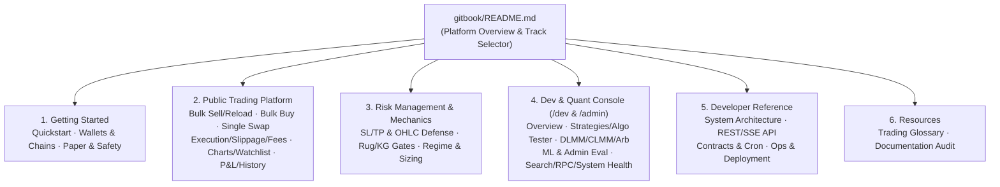

# Documentation Audit & Architecture Blueprint

This page documents the structural audit performed on reloadSol's pre-existing `docs/` library and explains the information architecture decisions behind this GitBook.

---

## 1. Executive Summary of Pre-Existing Docs Audit

Prior to building this GitBook, reloadSol possessed rich, deeply accurate engineering material—5 condensed subsystem docs (`docs/01`–`05`), **132** implementation `SPEC-*.md` files, **72** incident/analysis reports (`docs/reports/`), **13** deep research notes (`docs/research/`), and **26** HTML diagrams—but **no unified, navigable, trader-facing or developer-onboarding documentation site**.

### Key Findings from the Audit

| Audit Dimension | Finding in Legacy `docs/` | Impact on Readers | Resolution in This GitBook |
| :--- | :--- | :--- | :--- |
| **Audience Separation** | Public trader workflows (`/sell`, `/buy`, `/swap`, `/pnl`) were intermixed with internal Postgres migrations, Go cron internals, and bug post-mortems. | Traders struggled to find simple answers on slippage, ATA rent reclaim, or wallet setup; developers had to grep 90+ specs. | Split cleanly into **Getting Started → Public Trading Platform → Risk Management → Dev & Quant Console → Developer Reference**. |
| **Navigation & Structure** | No `SUMMARY.md`, no `.gitbook.yaml`, and no progressive disclosure; 150+ flat files across `docs/`, `docs/specs/`, and repo root (`architecture.md`, `PNL_AUTOMATION_SETUP.md`, empty `OPERATIONS_TRACKING_GUIDE.md`). | High cognitive load; impossible to browse linearly or publish directly to GitBook Git Sync. | Added `.gitbook.yaml` + hierarchical `SUMMARY.md` with **24** focused, cross-linked pages across 6 tracks and zero dead links (verified: 24 refs, 0 missing, 0 broken intra-page links). |
| **Missing Trader Guides** | No step-by-step guides for **Wallet Check + Ask-for-Fund**, **Bulk Buy affordability reserves**, **Robinhood Permit2 1-click setup**, **Dynamic Slippage**, or **In-Flight OHLC 3-Pattern Defense** in plain trading language. | Users misunderstood Phantom simulation behavior, Robinhood approval prompts, and fee drag on small stakes. | Authored dedicated step-by-step guides with GitBook ``, ``, `` callouts, and worked fee/payoff tables. |
| **Spec Drift & Retired Systems** | Several older root/archive docs referenced retired systems (`Supabase`, `v2-gate` / `v2-potential` ML heads, `Raptor` as desk executor, `-50%` RH stop fallback). | Risk of onboarding engineers or traders onto deprecated workflows. | Reconciled every page against current production code (`src/config/route-network.ts`, `src/config/api-access.ts`, `docs/01`–`05`, and Nov 2026 specs) and explicitly marked retired components. |
| **Visual Clarity** | Mermaid diagrams and sequence flows were missing from trader-facing docs (existing diagrams were standalone internal HTML files). | Execution lifecycle, BatchExecutor precedence, and 4-phase runner graduation were hard to grasp quickly. | Embedded clean, GitBook-native Mermaid flowcharts and sequence diagrams across Architecture, Execution, Risk, and Lifecycle pages. |
| **Terminology Standardization** | Terms like `ATA`, `OOR`, `MFE/MAE`, `Payoff Ratio`, `SHACL`, `Shadow vs. Enforce`, and `Bound vs. Parent Wallet` were used without centralized definitions. | Steep learning curve for newer traders and newly onboarded devs. | Added a centralized [Trading & Platform Glossary](glossary.md) covering both FinTech/trading and reloadSol-specific terms. |

---

## 2. Information Architecture Map

---

## 3. Recommended Next Steps for Publishing & Maintenance

1. **Connect GitBook Git Sync:** Point a GitBook space at this repository with root directory `gitbook/` (`.gitbook.yaml` is already configured).
2. **Add Annotated UI Screenshots:** Capture and drop light/dark screenshots into `gitbook/.gitbook/assets/` for:
   * `/` Wallet Check + Ask-for-Fund banner
   * `/sell/solana` dust categories & burn-close modal
   * `/swap/robinhood` Permit2 readiness checklist & receipt confirmation modal
   * `/pnl` open positions & inline Fast Sell
   * `/dev/algo-tester`, `/admin/lifecycle`, and `/analytics/knowledge-graph`
3. **Keep Docs Coupled to PRs:** Whenever a new route is added to `src/config/route-network.ts`, `src/config/api-access.ts`, or a new worker is registered in `main.go`, update the corresponding table in `gitbook/developer-reference/api-reference.md` or `smart-contracts-and-cron.md` in the same PR.
