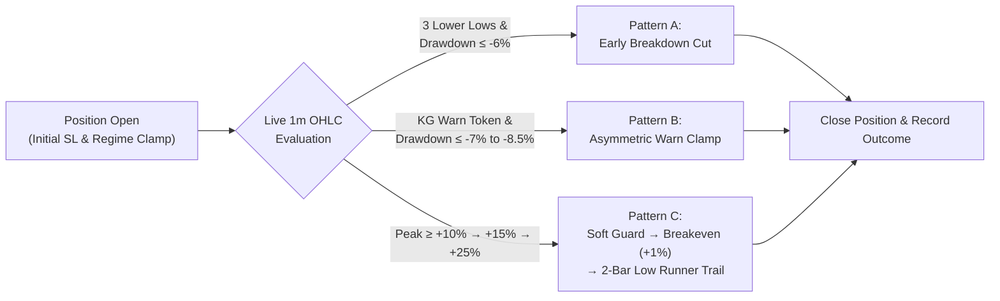

# Stop-Loss, Take-Profit & In-Flight OHLC Defense

In volatile on-chain markets, entry selection alone does not produce positive expectancy—**exit discipline** determines your payoff ratio ($R = \frac{\text{Avg Win}}{\text{Avg Loss}}$) and break-even win rate.

reloadSol enforces a **single-owner exit architecture** (Exit Standard S9) combined with active **In-Flight OHLC 3-Pattern Defense** to stop bleeders early and prevent `+25%` winners from round-tripping into losses.

---

## 1. Unified SL/TP Monitor (`sltp_monitor`)

Every open position—manual or automated, paper or live—is tracked in `sl_tp_positions` and governed by one dedicated worker (`sltp_monitor`, running every `60s` via `POST /api/sl-tp-monitor`):

* **Stamped Exit Contract:** At position open, the exact stop-loss (`SL`), take-profit (`TP`), and maximum hold duration (`max_hold`) are stamped onto the position row.
* **Sole Exit Owner:** Discovery workers (such as `mcap_tracker_sim_track`) never race to close positions; `sltp_monitor` is the single authority for closing trades, eliminating duplicate exits and conflicting close reasons.
* **Paper vs. Live Close Paths:**
  * **Paper (`is_simulation: true`):** Closes via `closeSimulatedPositionFromWorker`, writing the sell record, applying the round-trip paper fee (`0.0003 SOL` on Solana), and recording a `strategy_outcomes` row.
  * **Live (`is_simulation: false`):** Executes an on-chain sell via Jupiter Lite + server keypair (or manual wallet exit on user positions).

---

## 2. In-Flight OHLC 3-Pattern Defense

Static stop-losses (e.g., `-35%`) suffer from two empirical failure modes: slow-bleed tokens that grind all the way to the stop, and fast winners that spike `+20%` and give back 100% of their gains.

reloadSol's **In-Flight OHLC 3-Pattern Defense** (`src/strategies/graph/inflight-ohlc-defense.ts`) evaluates live 1-minute candles (`token_ohlc_bars`) across three active rules:

| Pattern | Trigger Condition | Action | Problem Solved |
| :--- | :--- | :--- | :--- |
| **Pattern A: 3-Bar Structural Breakdown** | 3 consecutive lower-low 1m candles with negative momentum ($\le -4\%$) while in drawdown | Early stop cut at **`-6%` to `-8%`** | Cuts confirmed structural dumps before they hit a deep static stop (`93.6%` empirical loss precision). |
| **Pattern B: Graduated Asymmetric Warn Clamp** | Token carries a Knowledge Graph `warn` tag (`20% ≤ bundlers < 35%`) | Tightens max stop-loss ceiling to **`-7.0%` to `-8.5%`** (stall clamp at `-5%` on scalp lanes) | Eliminates deep tail drag on partially bundled tokens (`98.8%` loss persistence past `-8%`). |
| **Pattern C: 3-Stage Dynamic Ratchet & Runner Trail** | Peak unrealized gain crosses `+10%`, `+15%`, and `+25%` | • At **`+10%`**: Soft guard raises SL to **`-2%`** • At **`+15%`** (`+18%` on scalps): Locks breakeven (**`+1.0%`**) • At **`≥ +25%`** (`≥ +30%` on scalps): Activates dynamic **2-bar low trail** $\min(L_{t-1}, L_{t-2})$ | Prevents profitable runners from round-tripping while letting exponential winners compound. |

---

## 3. Cross-Chain SL/TP Standardization & Rug Gap-Down Protection

On **Robinhood Chain (`4663`)**, pool-draining rugs can gap down `-95%` to `-100%` in under 70 seconds if left on a legacy `-50%` fallback stop. reloadSol's cross-chain protection standard (`SPEC-robinhood-sl-tp-standardization-and-protection-v1`) addresses this via:

* **Explicit Exit Profiles:** Tight DB-defined stop-loss (`-10%` to `-12%`), take-profit (`+35%` to `+50%`), and max hold (`2h` to `4h`) instead of wide fallbacks.
* **Pre-Entry Liquidity Floor:** Requires $\ge \$5,000$ TVL and $\ge 90\%$ LP lock/burn before entry.
* **Catastrophic Gap-Down Reclassification:** When a rug gaps past a stop by `overshoot_pts ≤ -30`, the outcome is tagged `label_rugged` with modeled stop slippage clamped at `1,000 bps` so liquidity rugs are isolated from normal stop-loss expectancy metrics.

---

## 4. Expectancy & Payoff Ratio Reference

When evaluating a strategy's exit profile in `/admin/strategy` or `/admin/replay`, reloadSol uses **median** return per trade (never raw mean, which a single `+5,000%` outlier can distort) alongside **Payoff Ratio ($R$)** and **Break-Even Win Rate**:

$$R = \frac{\text{Average Win \%}}{|\text{Average Loss \%}|} \qquad \text{Break-Even Win Rate} = \frac{1}{1 + R}$$

| Avg Win | Avg Loss | Payoff Ratio ($R$) | Break-Even Win Rate |
| :--- | :--- | :--- | :--- |
| `+20%` | `-20%` | `1.00` | **50.0%** |
| `+45%` | `-15%` | `3.00` | **25.0%** |
| `+60%` | `-10%` | `6.00` | **14.3%** |


**Test Exit Changes Before Shipping:** Use `/admin/replay` to replay candidate stop-loss, take-profit, and trailing-stop rules against reloadSol's stored 1-minute `token_ohlc_bars` (net of fees) before modifying any live strategy config.


---

## 5. Interactive Lab: In-Flight OHLC 3-Pattern Defense

Toggle **Pattern A**, **Pattern B**, and **Pattern C** below to inspect how reloadSol's active stop-loss line adapts bar-by-bar compared to a static stop:


Interactive reloadSol OHLC 3-Pattern Defense Simulator

