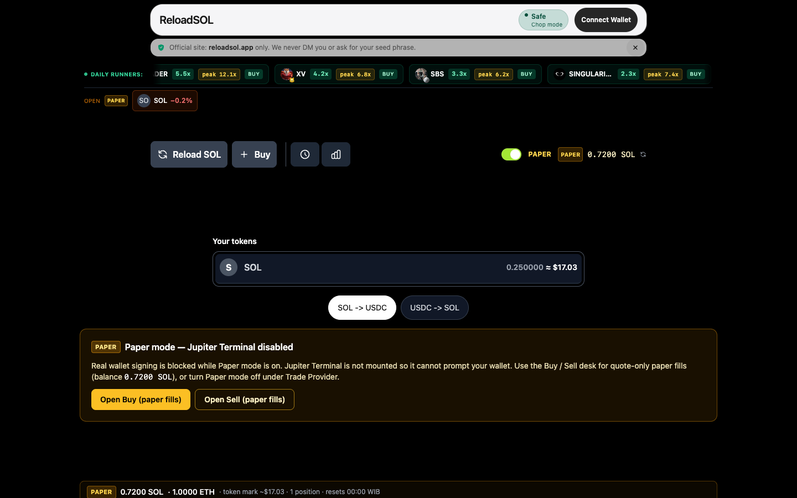

# Single swap

**TL;DR:** Use `/swap` for focused single-pair trades—**Jupiter Terminal** on Solana Mainnet (an embedded aggregator routing across Solana DEXs) and **RhSwap** (KyberSwap + Permit2) on Robinhood Chain.

[Open Single Swap →](https://reloadsol.app/swap/solana)







.png>)



***

## Swap a single pair in 3 steps



### Open Single Swap

Go to [https://reloadsol.app/swap/solana](https://reloadsol.app/swap/solana) (or [https://reloadsol.app/swap/robinhood](https://reloadsol.app/swap/robinhood) on Robinhood Chain).



### Pick input and output tokens

Select a quick preset (**SOL / USDC** on Solana; **ETH / WETH / USDG** on Robinhood Chain) or paste any token address, then enter your amount.



### Review route and confirm

Inspect the quoted output, [price impact](../start-here/trading-terms.md#quote-and-execution), and [slippage](../start-here/trading-terms.md#quote-and-execution), then approve the prompt in your wallet.



***

## Execution by network



* Powered by **Jupiter Terminal**, routing across Raydium, Orca, Meteora, Pump.fun, and other Solana DEXs.
* Supports native-to-token, token-to-native, and token-to-token swaps.
* In **Paper mode**, Jupiter Terminal is deliberately unmounted so it cannot trigger a real wallet signature—use [Bulk Buy](bulk-buy.md) or [Bulk Sell](bulk-sell-and-dust-reload.md) for paper fills instead.



* Powered by **KyberSwap Aggregator** through reloadSol's in-house swap panel.
* **Precedence:** One-click atomic **BatchExecutor** (after one-time Permit2 setup) → **EIP-5792** (`wallet_sendCalls`) → **Sequential** (Approve then Swap).
* Every mined receipt is checked—reverted transactions are always marked **Failed**, never **Confirmed**.




**No resting limit orders:** `/swap` executes spot market swaps at current pool liquidity. reloadSol does not place resting limit orders or exchange-side stop orders.


***

## Related

* [Order execution, slippage & fees](order-execution-and-mechanics.md)
* [Practice with Paper mode](../start-here/paper-mode.md)
* [Wallets & Supported Networks](../start-here/wallets-and-networks.md)
