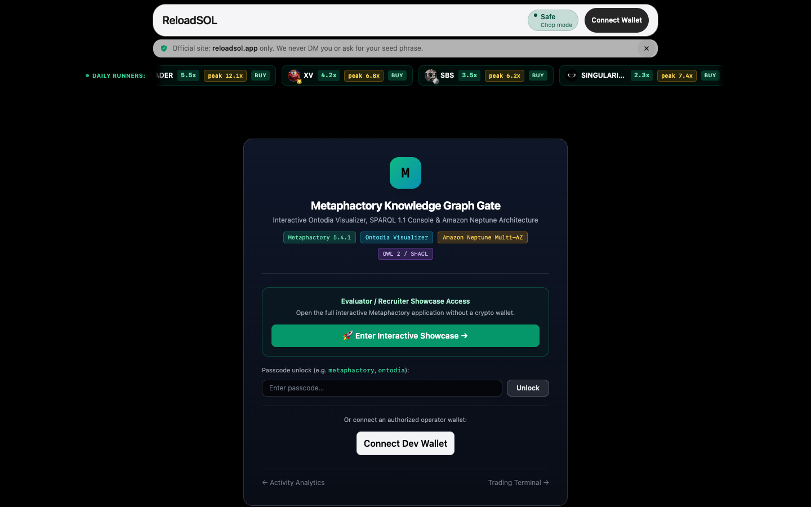

# Charts, watchlist & discovery

**TL;DR:** Open any Solana or Robinhood Chain token at `/chart/<tokenAddress>` to view live candles, check your position card, add to your cross-chain watchlist, or quick-buy without leaving the chart.

[Open Knowledge Graph →](https://reloadsol.app/knowledge-graph)

---

## Research and act from a chart



### Open a token chart

Navigate to `https://reloadsol.app/chart/<tokenAddress>` (or click any token from your watchlist, P&L, or [Analytics](https://reloadsol.app/analytics)).



### Check live metadata and your position

Review the live candlestick chart, USD price, market cap, and the **Your Position** card (displayed for both Solana and Robinhood Chain holdings).



### Add to Watchlist or Quick Buy

Click **Watchlist** to stream live percentage changes since you added the token, or open the keyboard-navigable **Chart Buy Modal** to enter a spot position directly.



---

## Public Knowledge Graph explorer

Visit [https://reloadsol.app/knowledge-graph](https://reloadsol.app/knowledge-graph) to inspect visual relationships around a token:

* **Deployer provenance:** Historical launches and graduation/rug patterns tied to the token's creator.
* **Holder clusters:** Wallets funded from shared roots or buying together in the same launch block.
* **Honest empty state:** When live holder or deployer data is unavailable for a brand-new token, the graph displays an explicit provenance banner rather than inventing fake nodes.


**Charts and graphs are informational only:** A clean graph or active chart does not guarantee a token is safe from a sudden liquidity pull. Always check liquidity depth and size positions conservatively.


---

## Related

* [Rug detection & knowledge graph](../risk-and-mechanics/rug-detection-and-knowledge-graph.md)
* [Bulk buy up to 4 tokens](bulk-buy.md)
* [P&L, trade history & portfolio](pnl-history-and-portfolio.md)
