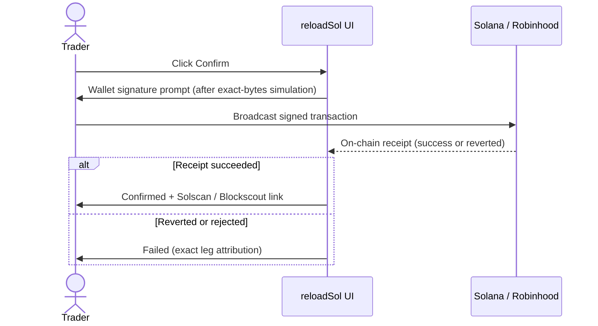

# Order execution, slippage & fees

**TL;DR:** Every swap is quoted fresh at click time, guarded against > **15%** price impact, simulated with exact bytes before signing, and marked **Confirmed** only after an on-chain receipt succeeds.

[Open reloadSol Sell →](https://reloadsol.app/sell/solana)

---

## Execution parameters

| Setting | Default | What it does |
| :--- | :--- | :--- |
| **Dynamic slippage** | **0.50% – 10.00%** (50–1,000 bps) | Scales automatically with token volatility; manual overrides are respected. |
| **Max price impact** | **15%** | Routes above 15% [price impact](../getting-started/trading-terms.md#quote-and-execution) are rejected before signing. |
| **Solana managed landing** | **Jupiter Swap V2** (~1.5s–2.1s) | Falls back to Shyft/Helius RPC if managed landing is unavailable. |
| **Platform fee** | **0.25%** (25 bps, when active) | Built into the same batch approval—**fail-open** so a fee issue never blocks your swap. |

---

## Receipt-gated confirmation lifecycle

A trade is **never** marked confirmed simply because you clicked approve. If a transaction reverts on-chain or expires, your history reflects **Failed** with the exact failing leg.


**Slippage vs. price impact:** Slippage protects you from price movement *while your transaction is in flight*. Price impact is caused by *your own order size* against pool liquidity. Raising slippage will not fix an illiquid pool.


---

## Related

* [What is checked before you sign](../getting-started/paper-trading-and-safety.md)
* [Trading terms in 5 minutes](../getting-started/trading-terms.md)
* [Troubleshooting & FAQ](../help/troubleshooting-and-faq.md)
