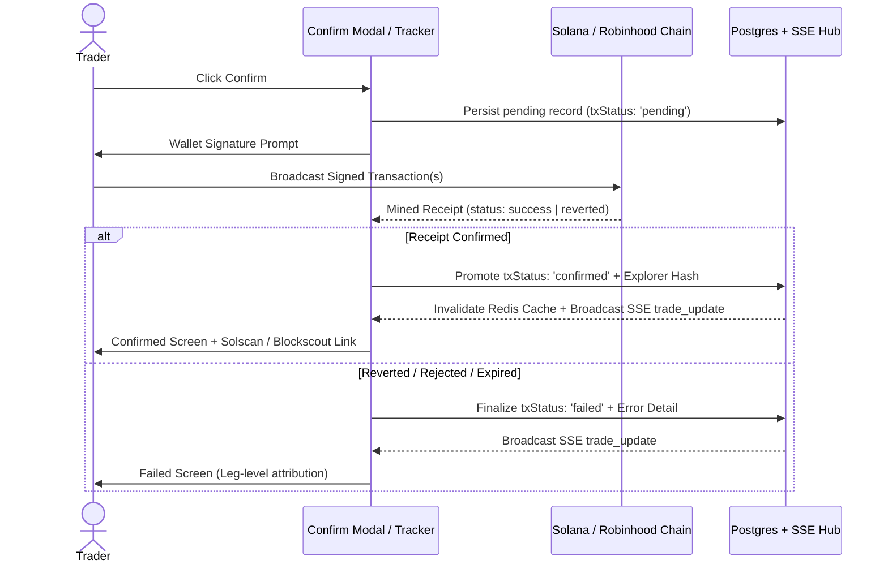

# Order Execution, Slippage & Fees

Understanding how orders are quoted, routed, protected against slippage, and confirmed on-chain is essential for trading volatile micro-cap and mid-cap markets effectively.

---

## 1. Two-Tier Quoting Architecture (Solana)

reloadSol separates **display estimates** from **executable orders** through a single unified quote engine (`src/utils/quote-engine.ts`, `src/hooks/useQuote.ts`) so that UI previews remain instantaneous without starving the execution rate limit:

| Purpose | Primary Provider | Caching | Use Case |
| :--- | :--- | :--- | :--- |
| **`purpose: 'estimate'`** | **SolanaTracker Raptor** (escalates to Jupiter if impact fails gate) | Keyed & shared across Bulk forms, Signals hovers, and PnL estimates | Fast sub-second batch previews without spending the `0.5 rps` Jupiter execution lane |
| **`purpose: 'execute'`** | **Jupiter Swap V2 `/order`** (falls back to **Jupiter Lite** only if V2 fails) | **Never cached** — always re-quoted fresh | Building actual signable v0 transactions for live execution |

### Per-Pair Hop Resolution (Raptor Estimates)
* Pairs involving **SOL, USDC, or USDT** use `RAPTOR_MAX_HOPS = 1` (direct pool).
* **Token-to-token** pairs use `RAPTOR_TOKEN_TOKEN_HOPS = 3` (since 1-hop token→token queries return `500 No direct route found`).
* Every estimate returns `outDecimals` read from the cached mint account so the UI renders exact human-readable token quantities—never guessing decimals.

---

## 2. Sub-Second Managed Landing (Jupiter Swap V2)

Solana desk swaps execute via **Jupiter Swap V2** (`GET /order` → wallet sign → `POST /execute`):

* **Managed Landing:** When `/order` returns a `requestId` and your wallet returns an unmodified transaction message, reloadSol submits the signed transaction to Jupiter's `/execute` endpoint. Typical end-to-end confirmation is **~1.5s–2.1s** (~`668 ms` on-chain), avoiding the 7–13 second RPC polling lag of raw broadcasts.
* **Resilient Fallback:** If `/execute` is unavailable or the wallet refreshed the blockhash, reloadSol falls back to **Shyft RPC** (rank-0 send lane) with WebSocket confirmation and Helius index failover.

---

## 3. Slippage & Price Impact Controls

### Dynamic Slippage
Volatile on-chain pairs frequently move between quote time and block inclusion. reloadSol calculates dynamic slippage automatically based on volatility brackets (`SPEC-trading-efficiency-and-slippage-refinement-v1`):

* **Floor:** `50 bps` (`0.50%`)
* **Ceiling:** `1,000 bps` (`10.00%`)
* **Intent-Aware High-Slippage Prompt (`shouldPromptHighSlippage`):** If you manually override slippage to a high value, reloadSol respects your explicit intent and avoids nagging with redundant confirmation dialogs while still warning when an automatic bracket spikes.

### Price Impact Guard
* **Maximum Impact Ceiling (`SWAP_QUOTE_MAX_IMPACT_PCT`):** Defaults to **`15%`**. Any route whose quoted price impact exceeds this ceiling is discarded before signing to protect traders from thin pools and sandwich extraction.

---

## 4. Platform Fee Settlement

reloadSol's platform fee architecture (`SPEC-platform-fee-settlement-v1`) is designed around two strict rules: **never slow down a swap** and **never cause a trade to fail**.

* **Standard Fee Rate:** `25 bps` (`0.25%`) native SOL transfer when settlement is enabled (`PLATFORM_FEE_SETTLE` runtime-delivered via `GET /api/swap/route-config`).
* **Zero Extra Wallet Prompts:** When active, the fee transfer is appended to the same `signAllTransactions` array (`N + 1`) using the batch's existing blockhash (zero extra RPC round trips).
* **Fail-Open Guarantee:** If fee construction or simulation fails, the fee leg is dropped and logged—your trade still executes cleanly.

---

## 5. Receipt-Gated Confirmation Lifecycle

reloadSol **never** marks a trade `confirmed` just because a wallet signed or an RPC accepted the bytes. State transitions are strictly receipt-gated:

* **Partial Batch Attribution:** In multi-token batches, every leg tracks its own signature and outcome (`successCount`, `failureCount`, `totalTokens`). If 4 of 5 legs confirm and 1 reverts, the 4 confirmed legs are accurately credited to your P&L and history while the 1 failed leg is clearly flagged.
