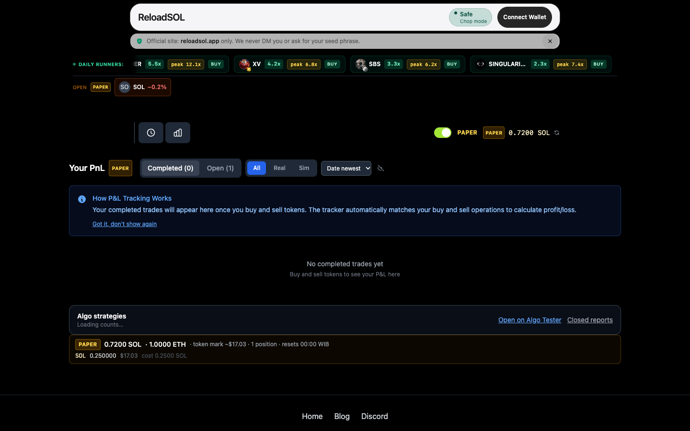
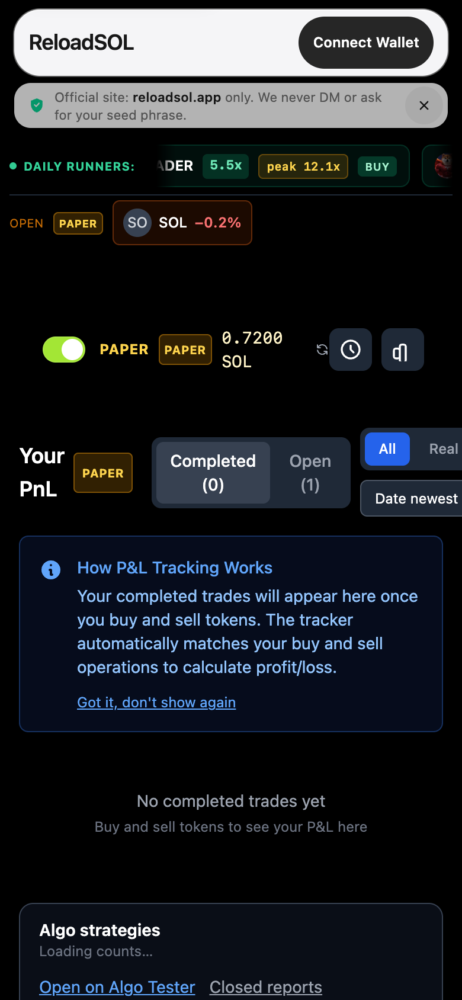
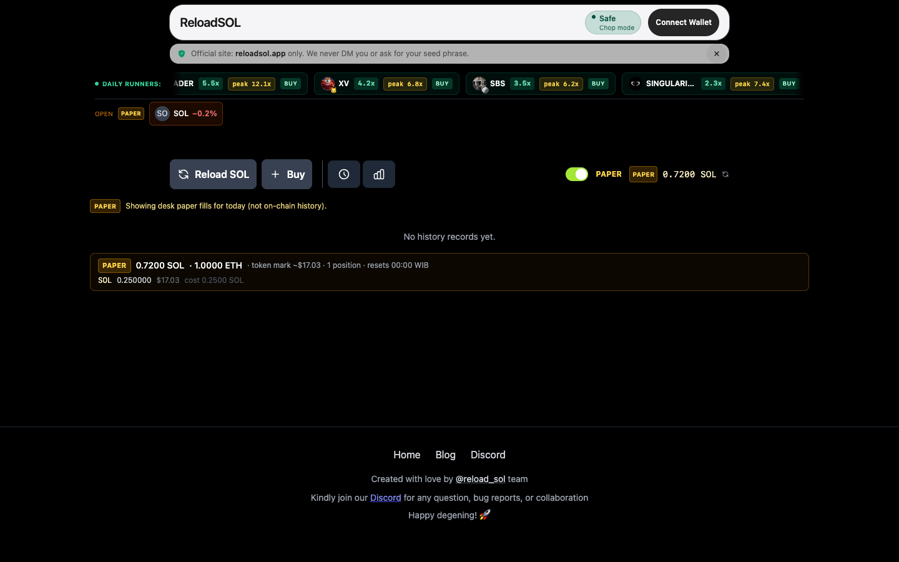
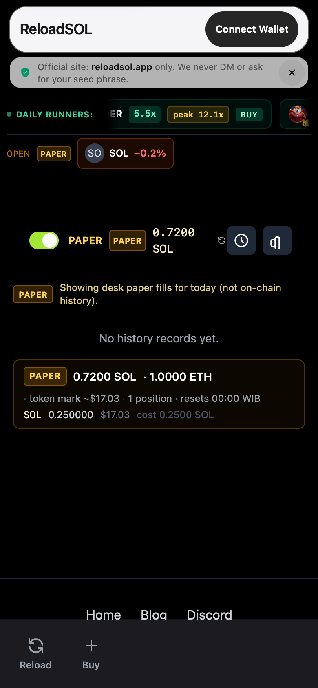

# P&L, trade history & portfolio

**TL;DR:** `/pnl` tracks your open positions and realized/unrealized P&L per wallet and per chain with inline **Fast Sell**; `/history` logs every confirmed, pending, or failed transaction with Solscan/Blockscout links.

[Open P&L Tracker →](https://reloadsol.app/pnl)



















---

## Review positions and Fast Sell



### Open your P&L Tracker

Go to [https://reloadsol.app/pnl](https://reloadsol.app/pnl) (or [https://reloadsol.app/history](https://reloadsol.app/history) for the full transaction log).



### Filter Real vs. Sim

Use the **Real / Sim** filter to separate live on-chain trades from [Paper mode](../getting-started/paper-mode.md) fills. Solana and Robinhood Chain records never mix.



### Close a position with Fast Sell

Click **Fast Sell** on any open token row to exit directly into native **SOL** (Solana) or **ETH** (Robinhood Chain) without navigating to `/sell`.



---

## How P&L and status badges work

| Indicator | Meaning |
| :--- | :--- |
| **Realized P&L** | Locked-in profit or loss from matched confirmed buys, sells, and closes, valued at trade-time native prices. |
| **Unrealized P&L** | Live mark-to-market value on tokens still held in your wallet (pruned automatically if you transfer them out). |
| **Confirming… (Amber)** | Transaction submitted and waiting for on-chain receipt. |
| **Confirmed (Green)** | On-chain receipt succeeded; updates push live via Server-Sent Events (no manual refresh needed). |
| **Failed (Red)** | Reverted on-chain or rejected in wallet; never counted as a fill. |


**Entry-time marks vs. current USD:** Historical USD valuations use the SOL/ETH price at the time of the trade so your past P&L does not distort when SOL or ETH moves later. Native assets (`SOL`, `ETH`, `WETH`, `USDG`) are excluded from open-position token rows.


---

## Worked trade example: P&L, fees & drawdown

Suppose you buy a Solana token with **0.1000 SOL** (`100%` spot collateral, no margin):

| Step | Action | Cash Flow (SOL) | Running Total |
| :--- | :--- | :--- | :--- |
| **1. Entry** | Buy 100% position (includes 0.5% price impact) | `−0.1000` · `−0.00015` fee · `−0.00204` ATA rent | `−0.10219 SOL` |
| **2. Partial exit (TP1)** | Sell **50%** after price rises **+40%** | `+0.0700` · `−0.00015` fee | `−0.03234 SOL` |
| **3. Pullback (Drawdown)** | Remaining 50% drops from `+40%` peak to `−10%` vs entry | — | Peak-to-trough DD on runner: **−35.7%** |
| **4. Final exit** | Sell remaining **50%** at **−10%** + auto-close ATA | `+0.0450` · `−0.00015` fee · `+0.00204` rent reclaimed | **`+0.01455 SOL` Net Realized P&L** |

* **Gross return:** `(0.0700 + 0.0450 − 0.1000) ÷ 0.1000` = **+15.00%**
* **Total network fees:** `0.00045 SOL` (**0.45%** fee drag — small because the `0.10 SOL` stake clears fixed costs)
* **Net Realized P&L:** **+0.01455 SOL (+14.55%)** — ATA rent was a refundable deposit, not a permanent loss.
* *Compare what happens on a tiny `0.005 SOL` stake:* the exact same `0.00045 SOL` in flat fees becomes **9.0% fee drag**, eating more than half of your gross profit. See [Risk basics](../risk-and-mechanics/risk-basics.md) for the interactive fee-drag calculator.

---

## Related

* [Sweep dust & reclaim rent](bulk-sell-and-dust-reload.md)
* [Practice with Paper mode](../getting-started/paper-mode.md)
* [Risk basics for spot traders](../risk-and-mechanics/risk-basics.md)
