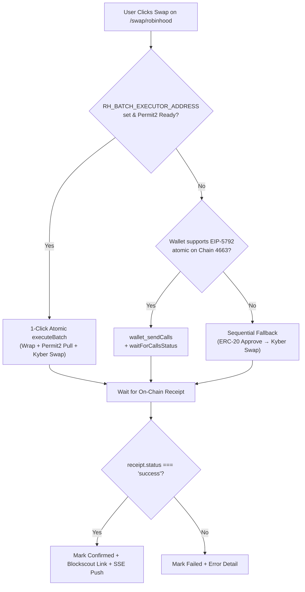

# Single Swap & Aggregator Routing

**Routes:** `/swap`, `/swap/solana`, `/swap/robinhood`

When you want to swap a single pair with full route visibility—rather than a multi-token batch—use `/swap`. ReloadSOL automatically renders the native execution engine for your active chain.

---

## Solana: Jupiter Terminal (`/swap/solana`)

On Solana Mainnet, `/swap` embeds the **Jupiter Terminal** widget pre-configured with **SOL** and **USDC** presets and connected directly to your active Solana wallet and RPC context.

* **Best-Price Aggregation:** Routes across Raydium, Orca, Meteora DLMM, Pump.fun, Lifinity, and other Solana DEX venues.
* **Direct & Multi-Hop Routing:** Supports native-to-token, token-to-native, and token-to-token swaps.
* **Instant Preset Pairs:** Quick toggles for SOL/USDC and any pasted SPL or Token-2022 mint address.

---

## Robinhood Chain: RhSwap (`/swap/robinhood`)

On Robinhood Chain (`4663`), `/swap` renders ReloadSOL's in-house **RhSwap Panel** (`RhGmgnSwapPanel.tsx`), supporting both quote-pair (`ETH`/`WETH`/`USDG` ↔ token) and direct token-to-token swaps.

### Parent Wallet Execution Precedence

When trading with a browser wallet (Rabby / EIP-6963), ReloadSOL automatically selects the cleanest available execution lane:

### One-Time Permit2 & BatchExecutor Setup

To unlock **1-click atomic swaps** on Robinhood Chain without repeating ERC-20 `approve()` transactions before every sell:

1. Approve your ERC-20 token once to the canonical **Permit2** contract (`0x0000...8BA3` on chain `4663`).
2. Grant Permit2 allowance to the `BatchExecutor` spender (`permit2.approve(token, spender, maxUint160, maxUint48)`).
3. Once readiness is active (`rh-permit2-readiness.ts`), every subsequent swap or multi-token batch requires **only one signature**.


**No Custody Transfer During Setup:** Permit2 setup only configures approval permissions—it never moves funds. Every trade still displays a full review modal (`GmgnTradeConfirmModal`) and requires your explicit wallet confirmation.

